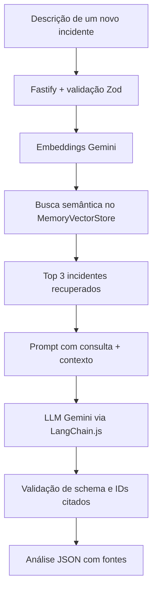

# IncidentRecall

**Recuperação de conhecimento e análise assistida por LLM para incidentes recorrentes de infraestrutura.**

IncidentRecall é uma API em **TypeScript** que combina **busca semântica** e **Gemini** em um fluxo de **Retrieval-Augmented Generation (RAG)**. A partir da descrição de um novo problema, ela recupera incidentes históricos semelhantes e utiliza esse contexto para gerar **hipóteses de investigação, evidências e verificações recomendadas**, com referência aos registros consultados.

O projeto nasceu de uma dificuldade comum em operações de TI: **incidentes semelhantes voltam a acontecer, mas localizar a resolução anterior pode exigir uma nova investigação manual**.

> **Escopo e segurança:** MVP local demonstrativo, com **15 incidentes sintéticos**. A ferramenta apoia a triagem; **não confirma causas**, não executa comandos nem modifica ambientes. Não utilize dados de clientes ou logs sensíveis.

## O que o MVP faz

- **Recupera incidentes relacionados**, mesmo quando a consulta usa palavras diferentes das registradas no histórico.
- **Gera análise contextualizada com uma LLM**, usando os incidentes recuperados como referência.
- **Retorna JSON estruturado**, com resumo, hipóteses, evidências, verificações e referências por hipótese.
- **Valida os IDs citados pela LLM** para impedir referências a registros não recuperados. Essa validação **não garante**, por si só, que uma hipótese esteja correta ou completamente sustentada.
- **Expõe endpoints HTTP** para busca e análise, com validação de entrada e tratamento de falhas do provedor de IA.

## Arquitetura: RAG com LangChain.js



O fluxo tem **duas etapas distintas**:

1. **Retrieval (recuperação):** um modelo de *embeddings* representa a consulta e os registros como vetores. A busca retorna os incidentes semanticamente mais próximos.
2. **Generation (geração):** a **LLM** recebe a descrição do incidente e os registros recuperados como contexto, produzindo uma análise estruturada. O backend valida o formato e as referências antes de responder.

O sistema **não treina nem ajusta** o Gemini com os dados dos incidentes: os registros são fornecidos como **contexto da requisição**. Similaridade semântica não é prova de mesma causa.

## Tecnologias

| Camada | Tecnologia |
| --- | --- |
| Runtime | Node.js 20+ |
| API | Fastify 5 |
| Linguagem | TypeScript + ESM |
| Validação | Zod 4 |
| Orquestração de IA | LangChain.js |
| Modelo de chat e embeddings | Gemini (`@langchain/google-genai`) |
| Busca vetorial | `MemoryVectorStore` (`@langchain/classic`) |
| Dados de demonstração | 15 incidentes fictícios em JSON |

## Executando localmente

### Pré-requisitos

- **Node.js 20+** e npm.
- Uma **chave da Gemini API** com acesso aos modelos configurados.

```bash
npm ci
cp .env.example .env
```

Configure o arquivo `.env`:

```dotenv
GOOGLE_API_KEY=sua_chave_aqui
GEMINI_CHAT_MODEL=modelo_disponivel_na_sua_conta
GEMINI_EMBEDDING_MODEL=gemini-embedding-001
PORT=3333
TOP_K=3
```

> **Nota:** na implementação atual, `/incidents/analyze` recupera **três** incidentes independentemente do valor de `TOP_K`. A variável está prevista para configuração futura. Não adicione a chave de API ao Git, ao README ou a capturas de tela.

Os modelos acessíveis e as cotas dependem da conta. Consulte a [lista de modelos](https://ai.google.dev/gemini-api/docs/models) e a [página de preços](https://ai.google.dev/gemini-api/docs/pricing).

Inicie a API:

```bash
npm run dev
```

Verifique a execução:

```bash
curl -i http://localhost:3333/health
```

Resposta esperada (`200 OK`):

```json
{"status":"ok"}
```

## API

### `GET /health`

Verifica se o servidor está ativo. Retorna `200` e `{"status":"ok"}`.

### `POST /incidents/search`

Recupera os incidentes mais similares à consulta. `query` é obrigatório; `limit` é opcional (`1` a `5`, padrão `3`).

```bash
curl -s http://localhost:3333/incidents/search \
  -H 'Content-Type: application/json' \
  -d '{"query":"Acesso por IP funciona, mas nomes internos não resolvem","limit":3}'
```

A resposta contém os incidentes recuperados, com `id`, `title`, `symptoms`, `cause` e `resolution`. A ordenação por similaridade **não representa probabilidade de diagnóstico correto**.

### `POST /incidents/analyze`

Executa o pipeline **RAG completo**: recupera até três registros, chama a LLM e valida a análise. `description` deve conter entre **10 e 2.000 caracteres**.

```bash
curl -s http://localhost:3333/incidents/analyze \
  -H 'Content-Type: application/json' \
  -d '{"description":"VPN da filial indisponível; timeout IKE e peer sem resposta"}'
```

**Exemplo ilustrativo de resposta** (o conteúdo gerado pode variar):

```json
{
  "summary": "Sintomas compatíveis com falha na negociação IKE.",
  "hypotheses": [
    {
      "description": "O tráfego IKE pode estar bloqueado no caminho.",
      "evidence": "INC-001 registra timeout IKE e ausência de resposta do peer.",
      "sourceIds": ["INC-001"]
    }
  ],
  "recommendedChecks": [
    "Verificar conectividade com o peer e registros de negociação IKE."
  ],
  "insufficientEvidence": false,
  "disclaimer": "A similaridade não confirma a causa do incidente atual.",
  "sources": ["INC-001", "INC-004", "INC-003"]
}
```

**Como interpretar as referências:**

- `hypotheses[].sourceIds`: incidentes que a LLM indica como suporte à hipótese. Os IDs são verificados contra os documentos recuperados.
- `sources`: lista de incidentes **recuperados**, montada pelo backend; nem todos necessariamente fundamentam cada hipótese.
- `insufficientEvidence`: sinalização gerada pela LLM. O sistema solicita que ela reconheça contexto insuficiente, mas **não possui um limiar calibrado e determinístico de abstenção**.

**Erros esperados:** `400` para entradas inválidas; `503` quando a integração com a IA falha ou retorna uma resposta que não passa pela validação. Detalhes internos e credenciais não são expostos no corpo da resposta.

## Validação do MVP

Os cenários abaixo foram **verificados manualmente na execução local**. Eles não constituem um benchmark estatístico nem demonstram redução de tempo de atendimento.

| Cenário | Resultado observado |
| --- | --- |
| Health check | `200 OK`, `{"status":"ok"}` |
| Busca por VPN com timeout IKE | `INC-001` em 1º lugar |
| Paráfrase sobre túnel VPN que não estabelece | `INC-001` em 1º lugar |
| Consulta de DNS: IP funciona, nomes internos falham | `INC-005` em 1º lugar |
| Análise RAG de VPN | `200 OK`, resposta estruturada citando `INC-001` |
| Descrição abaixo do limite mínimo | `400 Bad Request` |

**Testes automatizados:** ainda não implementados. Embora `npm test` esteja configurado no `package.json`, não há uma suíte executada que sustente alegações de cobertura.

## Estrutura do projeto

```text
src/
├── app.ts
├── server.ts
├── data/
│   └── incidents.json
├── routes/
│   ├── health.ts
│   └── incidents.ts
├── schemas/
│   └── incidents.ts
└── services/
    ├── prompt.ts
    ├── rag.ts
    └── vector-store.ts
```

## Limitações atuais

- **Dados sintéticos:** o MVP não está conectado a plataformas corporativas de chamados.
- **Sem persistência vetorial:** o índice fica na memória e precisa ser reconstruído após reiniciar o processo. A primeira busca gera os embeddings da base.
- **Sem avaliação formal de relevância:** o mecanismo retorna os vetores mais próximos, sem um limite mínimo de similaridade calibrado.
- **Possibilidade de hipóteses incorretas:** a LLM pode interpretar mal evidências. A verificação de IDs impede referências inexistentes entre os recuperados, mas não valida a veracidade do texto gerado.
- **Dependência externa:** embeddings e análise dependem da disponibilidade, cotas e possíveis custos da Gemini API.
- **Escopo local:** sem autenticação, deploy, telemetria, ingestão automática, execução de ações ou alterações de infraestrutura.

## Evoluções planejadas

1. Criar **testes automatizados** para schemas, endpoints e pipeline RAG com mocks.
2. Criar um conjunto de avaliação com consultas rotuladas, medindo **Recall@3** e qualidade das respostas.
3. Tornar `TOP_K` efetivamente configurável e investigar critérios de insuficiência de contexto.
4. Adicionar persistência do histórico e dos vetores.
5. Avaliar integração com uma ferramenta de chamados, com controles de acesso e anonimização antes de enviar dados a modelos externos.

## Referências

- [LangChain.js — documentação](https://docs.langchain.com/oss/javascript/langchain/overview)
- [Integração Gemini no LangChain.js](https://reference.langchain.com/javascript/langchain-google-genai)
- [Gemini API — modelos](https://ai.google.dev/gemini-api/docs/models)
- [Gemini API — preços](https://ai.google.dev/gemini-api/docs/pricing)

---

**IncidentRecall é um projeto demonstrativo de engenharia backend com IA.** Seu objetivo é explorar como recuperar conhecimento de ocorrências anteriores e oferecer contexto útil à investigação de incidentes recorrentes — sem substituir a avaliação técnica de um profissional.
